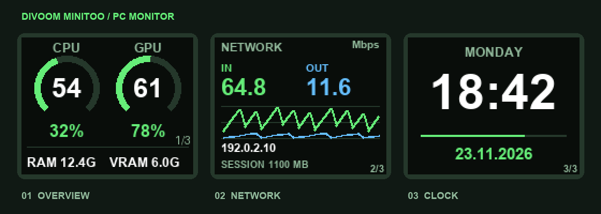
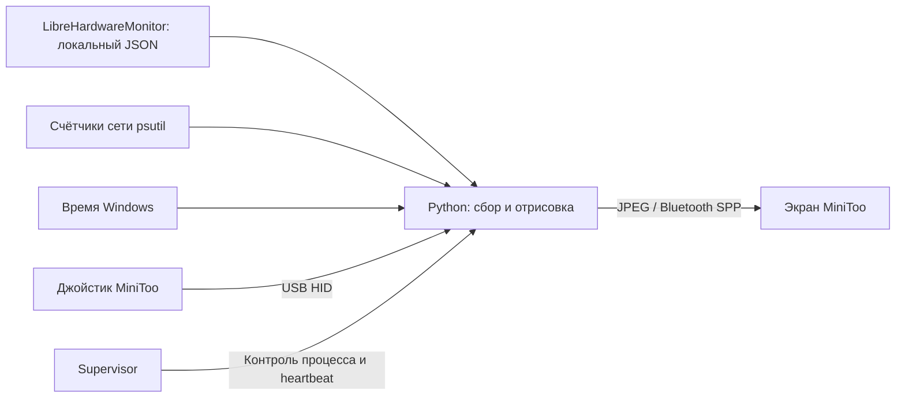

> **⚠️ Проект навайбкоден. Оформление этого репозитория и сама выгрузка на GitHub тоже навайбкодены с помощью ИИ.** Это любительский эксперимент: код может содержать ошибки, а совместимость с другим железом и прошивками не гарантируется.

# Divoom MiniToo · PC Monitor

Небольшой монитор состояния Windows-ПК на экране **Divoom MiniToo**. Показывает температуру и загрузку процессора и видеокарты, занятую память, сетевой трафик и часы. Страницы переключаются физическим джойстиком MiniToo.

Это способ превратить настольную колонку в отдельный экран со статистикой: показатели остаются перед глазами во время игры, работы или рендеринга.



*Изображения сгенерированы штатным рендерером проекта на демонстрационных данных. Это макеты кадров 160×128, не фотографии устройства.*

## Что умеет

| Страница | Содержимое |
| --- | --- |
| **Overview** | Температура CPU/GPU в °C, загрузка в %, RAM/VRAM в ГБ |
| **Network** | Входящий и исходящий трафик в Мбит/с, график 30 замеров, IPv4 и объём за сеанс |
| **Clock** | Локальное время ПК, день недели, дата и прогресс часа |

Джойстик влево/вправо листает страницы по кругу. Недоступные датчики отображаются как `--`. При сбое передачи монитор переподключает Bluetooth с увеличением паузы; отдельный supervisor перезапускает завершившийся или зависший процесс.

## Как это работает



**Bluetooth передаёт картинку, USB передаёт нажатия.** Для переключения страниц нужен USB-кабель с передачей данных. Одного питания по USB недостаточно. Проект использует штатные интерфейсы Windows и не требует перепрошивки MiniToo или замены драйвера.

## Что понадобится

- Windows 10/11 x64 и Divoom MiniToo с Bluetooth SPP.
- Python **3.11+**. Исходная рабочая установка использовала Python 3.14; аппаратная совместимость других установок не проверена.
- Bluetooth-адаптер и USB-кабель с передачей данных.
- [LibreHardwareMonitor](https://github.com/LibreHardwareMonitor/LibreHardwareMonitor) с включённым веб-сервером для CPU/GPU и памяти.
- Три Python-зависимости: Pillow, pyserial и psutil. HID читается через встроенные Windows API.

Сеть и часы работают без LibreHardwareMonitor. Первоначальная настройка датчиков была проверена на AMD Ryzen 7 7700 и NVIDIA GeForce RTX 5060 Ti; для другого ПК потребуется проверить имена датчиков.

## Быстрый старт

### 1. Подключите устройство и источник датчиков

1. Выполните сопряжение MiniToo с Windows по Bluetooth.
2. Найдите **исходящий COM-порт SPP** устройства в параметрах Bluetooth или диспетчере устройств. В исходной установке это был `COM3`; у вас номер может отличаться.
3. Подключите USB для джойстика.
4. Запустите LibreHardwareMonitor, включите веб-сервер и откройте `http://localhost:8085/data.json`. Должен появиться JSON с деревом датчиков. Если порт другой, укажите его в конфигурации. Держите сервер доступным только там, где он вам нужен: проект читает его локально.

### 2. Установите зависимости

В PowerShell из папки проекта:

```powershell
python -m venv .venv
.\.venv\Scripts\python.exe -m pip install -r requirements.txt
Copy-Item config.example.json config.json
```

Если `python` не найден, используйте `py -3` либо полный путь к установленному интерпретатору. Активация окружения не требуется.

### 3. Настройте config.json

```json
{
  "port": "COM3",
  "sensor_url": "http://localhost:8085/data.json",
  "interval": 3,
  "jpeg_quality": 75,
  "cpu_name": "",
  "gpu_name": "",
  "cpu_temperature_sensor": "Core (Tctl/Tdie)"
}
```

| Параметр | Значение |
| --- | --- |
| `port` | Исходящий Bluetooth SPP COM-порт |
| `sensor_url` | Адрес JSON LibreHardwareMonitor |
| `interval` | Целевой период обновления обзора и сети, 0,2–60 секунд |
| `jpeg_quality` | Качество JPEG, целое число 1–95 |
| `cpu_name`, `gpu_name` | Точные имена устройств в поле `Text` дерева JSON; пустая строка выбирает первый подходящий датчик |
| `cpu_temperature_sensor` | Имя температуры CPU; для исходного AMD это `Core (Tctl/Tdie)`, у Intel может быть `CPU Package` |

Для нескольких GPU укажите точное имя нужной карты. Используются категории `Temperatures`, `Load`, `Data` и датчики `CPU Total`, `GPU Core`, `Memory Used`, `GPU Memory Used`. Предполагается, что LHM отдаёт RAM в ГБ, а VRAM в МБ. Если ваша версия выдаёт другие имена или единицы, настройте выборку в `read_sensors()` в `pc_monitor.py`.

`config.json` игнорируется Git. Если его нет, используются значения по умолчанию из `monitor_config.py`.

### 4. Запустите монитор

```powershell
.\.venv\Scripts\python.exe pc_monitor.py
```

Для запуска с автоматическим восстановлением:

```powershell
.\.venv\Scripts\python.exe monitor_supervisor.py
```

Для фонового запуска без окна дважды щёлкните `start_monitor.vbs`. Он использует Python из `.venv` рядом с проектом.

Монитор пишет сообщения в `monitor.log`, а текущее состояние — в `monitor_status.json`. Консоль самого монитора после запуска остаётся без подробного вывода: смотрите журнал.

## Автозапуск Windows

После успешного ручного запуска:

```powershell
powershell -NoProfile -File .\scripts\install-autostart.ps1
```

Скрипт создаёт задачу **MiniToo PC Monitor** для текущего пользователя: запуск при входе с задержкой 30 секунд, без повышенных прав. Если Windows отклоняет регистрацию задачи, проверьте права пользователя и политику Task Scheduler. Существующую задачу скрипт не перезаписывает. Для другого имени используйте `-TaskName 'MiniToo Public Monitor'`.

Удаление созданного автозапуска:

```powershell
powershell -NoProfile -File .\scripts\remove-autostart.ps1
```

Удаление задачи не гарантирует завершения уже запущенного дочернего процесса. Для полной остановки сначала остановите supervisor, затем его worker в диспетчере задач, сверив путь к скрипту. При ручном запуске worker можно остановить `Ctrl+C`; supervisor следует остановить первым, иначе он запустит worker снова.

Не запускайте вторую копию рядом с уже работающей установкой. Именованные mutex общие для сеанса Windows и блокируют повторный запуск worker/supervisor.

## Если что-то не работает

| Симптом | Что проверить |
| --- | --- |
| На экране нет нового изображения | Сопряжение Bluetooth, исходящий COM-порт и отсутствие другой программы, открывшей этот порт |
| CPU/GPU показывают `--` | Доступность `data.json`, точные имена устройств, категории и имена датчиков |
| Джойстик не переключает страницы | USB-кабель с данными; `python usb_hid_probe.py` должен обнаружить MiniToo `4C4A:4E55` |
| Нужна запись нажатий | `python usb_hid_probe.py --seconds 15 --no-file`; сначала остановите монитор |
| Частые переподключения | `monitor.log` и `supervisor.log`; качество Bluetooth и питание MiniToo; при зависании устройства может потребоваться его выключение и включение |
| После старта ничего не происходит | Не работает ли уже другая копия; корректен ли `config.json`; есть ли `.venv` и зависимости |

## Ограничения

- Поддерживается текущий Windows-путь проекта. Linux, macOS, другие модели Divoom и другие прошивки не проверены.
- Передача полного кадра занимает время: период 3 секунды — цель, фактическое обновление ограничено Bluetooth и обработкой на устройстве. Переключение страницы ждёт завершения текущего кадра.
- Часы обновляются при входе на страницу и смене минуты; секунд нет.
- Сеть показывает реальный текущий трафик одного автоматически выбранного интерфейса, а не скорость тарифного плана или результат speedtest. Выбор интерфейса при VPN может потребовать доработки.
- Полная передача определяется по полученным запросам всех блоков и финальному ACK либо паузе 2,2 секунды. Это не независимая проверка изображения на физическом дисплее.
- `monitor.log` и `supervisor.log` ротируются. Подробные `minitoo_rx_*.log` создаются при каждом соединении и **не имеют общей автоматической очистки**; следите за размером папки.
- Журналы, статус и HID-диагностика могут содержать локальные пути и идентификаторы устройств. Перед приложением к issue просматривайте их содержимое.

## Для разработки

```powershell
.\.venv\Scripts\python.exe -m unittest discover -v
.\.venv\Scripts\python.exe preview.py
```

Тесты не открывают COM-порт и не отправляют команды MiniToo. GitHub Actions содержит проверки на Windows с Python 3.11 и 3.14; они не заменяют проверку на физическом устройстве.

| Файл | Назначение |
| --- | --- |
| `pc_monitor.py` | Датчики, основной экран, HID-навигация, передача и восстановление связи |
| `dashboard_pages.py` | Сетевые счётчики, страницы сети и часов |
| `minitoo_windows.py` | Формирование SPP-пакетов, JPEG и блоков изображения |
| `usb_hid_probe.py` | Обнаружение и чтение HID MiniToo через WinAPI |
| `monitor_supervisor.py` | Перезапуск worker и контроль heartbeat |
| `monitor_config.py` | Загрузка и проверка локальной конфигурации |
| `preview.py` | Воспроизводимые иллюстрации без устройства и реальной телеметрии |
| `scripts/` | Установка и удаление автозапуска |

Подробности обмена — в [заметках о протоколе](docs/PROTOCOL.md), контекст публикации — в [истории проекта](docs/PROJECT.md).

## Благодарности

Проект независимый и не связан с Divoom. Название устройства принадлежит его правообладателю. [LibreHardwareMonitor](https://github.com/LibreHardwareMonitor/LibreHardwareMonitor), [Pillow](https://github.com/python-pillow/Pillow), [pyserial](https://github.com/pyserial/pyserial) и [psutil](https://github.com/giampaolo/psutil) распространяются отдельно на своих условиях. APK, декомпилированные исходники производителя и сторонние бинарные файлы в этот репозиторий не включены.
